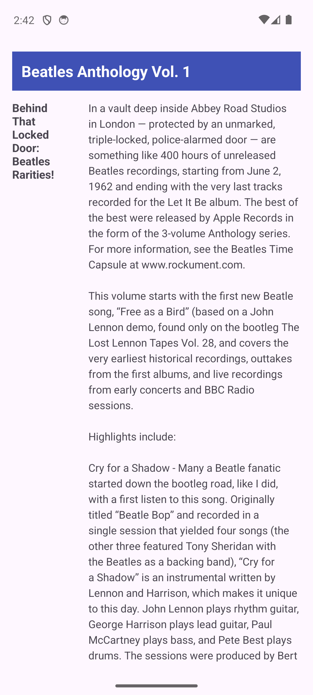
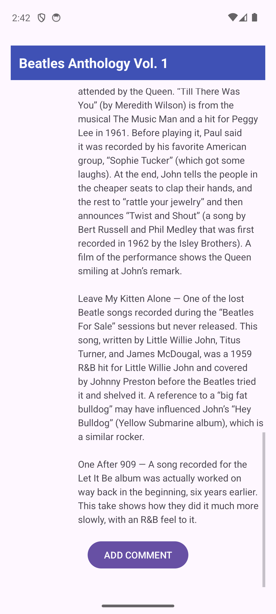
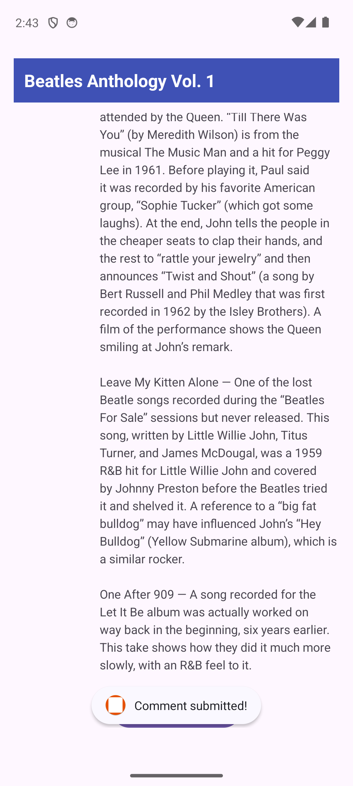

# Drsno besedilo (ScrollingText)

Preprosta Android aplikacija za prikaz daljšega besedila v drsnem pogledu, narejena pri predmetu MOAp. Namen naloge je spoznavanje elementa ScrollView in razporeditve več stolpcev besedila.

## Opis aplikacije

Aplikacija vsebuje naslednje elemente uporabniškega vmesnika:
- Zgornji naslov članka (**Beatles Anthology Vol. 1**).
- Drsni pogled (`ScrollView`) z dvema stolpcema:
  - Levi stolpec za podnaslov članka.
  - Desni stolpec za celotno besedilo članka.
- Gumb **ADD COMMENT**, ki se nahaja na dnu besedila znotraj drsnega pogleda.
- Ob kliku na gumb **ADD COMMENT** se prikaže kratko obvestilo (Toast) z besedilom `Comment submitted!`.

Vsa besedila v aplikaciji so shranjena v `strings.xml`.

## Posnetki aplikacije
| | | |
|---|---|---|
||||
